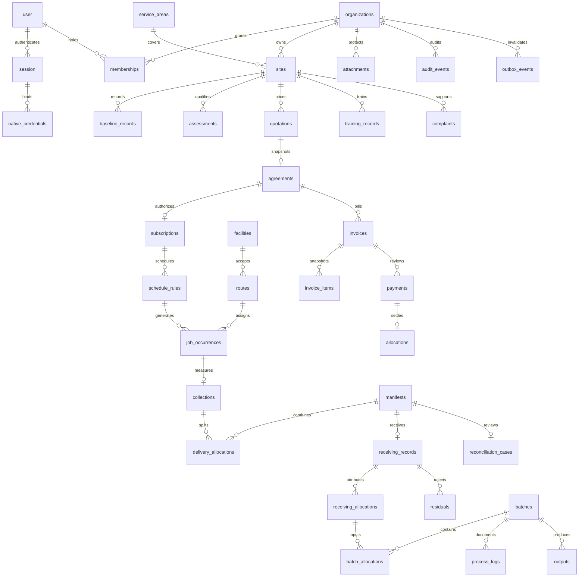

# Decisions, invariants and schema

## Reference verification

Official references consulted during implementation (8 November 2026):
- [Expo version compatibility](https://docs.expo.dev/versions/latest/): SDK 58 / RN 0.88 / React 19.3 / Node >=22.13. Dependency resolution must still pass Expo's installed compatibility check.
- [Expo builds](https://docs.expo.dev/deploy/build-project/): EAS signing/accounts required for store artifacts; Metro/export is not a signed build.
- [Better Auth Expo](https://www.better-auth.com/docs/integrations/expo): server/client Expo plugins, SecureStore, trusted custom scheme. Its example targets older SDK 55; use actual installed types/Expo checks, not blindly copy its version numbers.
- [Neon pooling](https://neon.com/docs/connect/connection-pooling): pooled runtime URL, direct migration/backup URL, transaction mode. No LISTEN/NOTIFY or session-scoped state.
- [Vercel Node functions](https://vercel.com/docs/functions/runtimes/node-js): shared fetch handler and rewrites. Node 24, no persisted uploads/local DB.
- [Tailwind Vite](https://tailwindcss.com/docs/installation/using-vite): v4 plugin and CSS import.

React/React Native release documentation is linked from Expo's compatibility guide. Exact package resolutions belong in `pnpm-lock.yaml`; install verification is separately reported. A pre-existing pnpm root-only install appeared during setup; it was preserved and expanded to real workspaces. Failed npm attempts must not be mistaken for a working lockfile.

## Reversible choices

1. Single Node/Hono versioned API, Vercel fetch entry; `pg` pool max 5 + Drizzle transactions against Neon pooled runtime URL. Direct URL for checksummed migration runner. Local PostgreSQL for integration, never SQLite.
2. Normalized SQL migration is schema authority; Drizzle SQL builder parameterizes all runtime values. API uses integer grams to avoid rounding; money uses integer minor units within bounded JS-safe transaction values. Currency conversion is absent.
3. Better Auth web identity/cookies; native exchange creates hashed opaque ten-minute access/fourteen-day rotating refresh credentials bound to the underlying one-day auth session. Refresh cannot extend a revoked/expired parent session. Reuse revokes a refresh family. Secrets only in native SecureStore.
4. Shared permissions and workflow descriptors, but separate DOM and React Native rendering. Native StyleSheet mirrors shared forest/emerald tokens.
5. Explicit 5-second authoritative scoped polling is active. Outbox persists in transaction; optional Ably publisher is bounded/awaited. Authorized token/channel fan-out is not activated, so no live delivery SLA is claimed.
6. Private S3 signed PUT/GET adapter with authorization, metadata and quarantine. No unreviewed downloads. Malware/content review and parent-entity linking remain incomplete: do not enable production evidence files yet.
7. Collection/receiving originals are distinct. Proportional receiving allocation is cumulative integer apportionment by source collected mass, explicitly submitted for review. It conserves receiving totals without pretending discrepancies disappeared. Received mass may differ from source pickup; treatment cannot exceed accepted allocations when P1 is implemented.
8. All mutating commands require scoped idempotency keys. Transaction-scoped advisory locks serialize identical first requests; same key/different content is 409. Route/source/invoice row locks serialize constrained balances. No last-write-wins financial/weight edits.

## Core ERD

See migration for actual tables/checks/foreign keys. Not all requested P1/P2 entities are implemented. Stop order, vehicle availability/capacity, holiday rules and plan bounds need dedicated normalized entities/constraints before general rollout.
Versioned schedule calendars, normalized pauses/area closures, subscription date controls and linked rescheduling have since been added in migrations 0004/0005. See `SCHEDULING.md` for current generation, DST, concurrency, preservation and scheduler policies; vehicle/capacity and commercial plan-bound work remains incomplete.

## State transitions

Pickup permitted edges are executable in `pickupEdges`. Assignment must start at SCHEDULED; capture must start at ARRIVED, by assigned collector, matching entity version, active site and accepting facility/material. Partial finalization requires residual grams/reason and creates a destination exception.

Delivery implemented path: DISPATCHED → DELIVERED → RECEIVING_RECORDED or RECONCILIATION_REQUIRED → RECONCILED. Receiver must belong to destination facility and differ from dispatch actor. A reviewer cannot review their own receiving. CLOSED/correction version workflow is not released.

Financial implemented path: invoice ISSUED → PARTIALLY_PAID / PAID via confirmed payment allocations. Evidence PENDING_REVIEW → CONFIRMED / REJECTED; no self-review, mixed currency, duplicate confirmed reference or allocation above balance. Draft/void/credit/refund/overdue automation remains incomplete.

Outbox attempts use bounded backoff, row locks, dead-letter after eight failures. A scheduler must repeatedly call the authenticated internal endpoint; no unawaited background promises.

## Public startup and build output

`bootstrap.ts` loads the small CSS/bootstrap layer. Production `/` is public-only React-rendered static HTML built by `apps/web/scripts/prerender.tsx`, with ordinary links and no required client state; it does not load auth, protected query caches, charts or the React runtime. Development and non-home routes load `main.tsx`, then lazy `ApplicationShell` / operational routes and providers. Application chunk failures give an honest reload/error state rather than implying a successful submission. No DB/auth state is imported during public prerender; protected API responses are never service-worker cached.

See `PERFORMANCE.md` for measured conditions, prior misses, a subsequent preliminary budget pass and remaining deployment/hardware acceptance. This optimization does not claim immediate application-route interactivity or signed native runtime verification.
